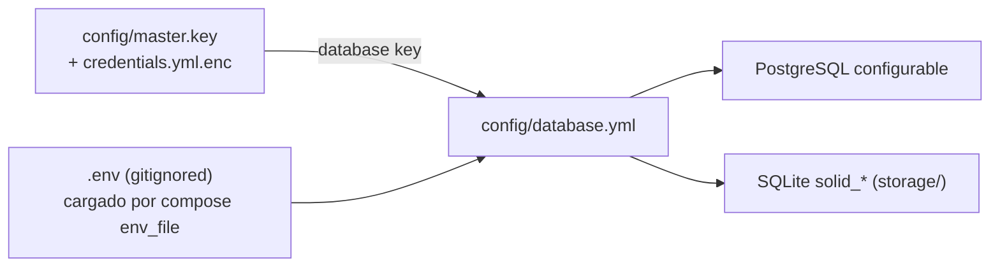
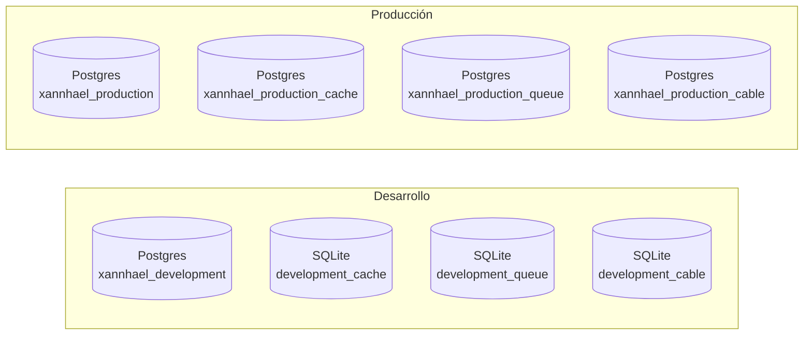

# 02 · Configuración

Esta app necesita cierta configuración para arrancar. La buena noticia: el
**devcontainer la prepara casi toda solo**. Aquí verás qué existe, por qué
existe y cuándo debes tocarla.



## 1. Credenciales de Rails (alternativa)

`config/master.key` + `config/credentials.yml.enc` guardan datos sensibles
cifrados. Si no defines las cuatro variables `DB_HOST`, `DB_PORT`,
`DB_USERNAME` y `DB_PASSWORD`, Rails puede leerlas de la clave `database`:

```yaml
database:
  host: host.docker.internal
  port: 55432
  username: postgres
  password: postgres
```

Para verlas o editarlas:

```bash
bin/rails credentials:edit
```

En el Dev Container, Compose define las cuatro variables `DB_*` con valores
predeterminados y puedes cambiarlas desde `.env`; esas variables prevalecen
sobre Rails credentials. Fuera del contenedor, Rails usa la clave `database`
si falta alguna variable.

## 2. PostgreSQL compartido o local

Por defecto la app se conecta a PostgreSQL en el host Docker
(`host.docker.internal:55432`). El nombre del contenedor del host no importa.
Si usas el ejemplo `postgres-db` del README, arráncalo manualmente:

```bash
docker start postgres-db
```

Inicia el contenedor de PostgreSQL manualmente cuando lo necesites. El
Dev Container no arranca ni modifica servicios externos por sí solo.

## 3. Variables de entorno

### Fuente única: `.env`

**Todo** vive en un único `.env` en la raíz del repo. Está en `.gitignore`; lo
versionado es `.env.example`, que documenta cada variable y trae los valores de
desarrollo que ya funcionan:

```bash
cp .env.example .env   # solo la primera vez, o en cada clone nuevo
# y rellena las claves que vienen vacías (ver tabla de abajo)
```

Lo carga Docker Compose en el devcontainer mediante `env_file: ../.env` (ver
`.devcontainer/compose.yaml`). Por eso el `containerEnv` de `devcontainer.json`
no contiene credenciales a propósito:

> 🔒 No repitas estas claves en `containerEnv`: haría *shadowing* y
> sobrescribiría en silencio lo que pongas en `.env`.

`env_file` usa `required: false`, así que el contenedor puede arrancar aunque
`.env` falte. Las claves de Codex, GitHub y Kamal son opcionales; solo se
necesitan al utilizar esos servicios. Puedes ejecutar
`.devcontainer/check-tools-env.sh` manualmente para comprobarlas. No se
reenvían estas variables desde el host.

### Ya vienen rellenados (defaults de desarrollo)

| Variable | Para qué sirve |
|----------|----------------|
| `DB_HOST` / `DB_PORT` | Host y puerto de PostgreSQL (por defecto `host.docker.internal:55432`; `db:5432` en modo local) |
| `DB_USERNAME` / `DB_PASSWORD` | Usuario y contraseña PostgreSQL; en un servidor compartido, usa un usuario propio por proyecto |
| `PGHOST` / `PGPORT` / `PGUSER` / `PGPASSWORD` | Los mismos valores para el cliente `psql`, configurados por Compose |
| `SELENIUM_HOST` / `CAPYBARA_SERVER_PORT` | Tests de sistema (Selenium arranca bajo demanda) |
| `RUBY_DEBUG_OPEN` / `RUBY_DEBUG_LAZY` | Depurador remoto (`debug`) |

### Tú las rellenas (vienen comentadas/vacías en `.env.example`)

| Variable | Usada por | Propósito |
|----------|-----------|-----------|
| `OPENAI_API_KEY` | codex | Autenticación OpenAI |
| `GITHUB_TOKEN` / `GH_TOKEN` | `gh` + `git push` (HTTPS) | Autenticación de GitHub: la usa `gh` y el helper de credenciales `!gh auth git-credential`. Scopes: `repo`, `workflow`, `read:org`, `read:project` |
| `KAMAL_REGISTRY_PASSWORD` | kamal | Autenticación del registry |
| `XANNHAEL_DATABASE_PASSWORD` | producción | Password de la DB en prod |
| `DATABASE_URL` | CI | URL completa (solo GitHub Actions) |
| `RAILS_MASTER_KEY` | CI / producción | Solo si no existe `config/master.key` |

### Opcionales (comentadas; descomenta para cambiar el default)

| Variable | Default | Para qué sirve |
|----------|---------|----------------|
| `RAILS_ENV` | `development` | Entorno de Rails |
| `PORT` | `3000` | Puerto de Puma |
| `RAILS_MAX_THREADS` | `5` | Hilos/conexiones por worker |
| `WEB_CONCURRENCY` | `1` | Workers de Puma (2+ para multiproceso) |
| `SOLID_QUEUE_IN_PUMA` | `1` | Corre Solid Queue dentro de Puma (deploy único) |
| `JOB_CONCURRENCY` | `1` | Procesos worker de Solid Queue |

> Las credenciales de Codex y GitHub se definen en el `.env` del proyecto.
> OpenCode Go/Zen se conecta con `/connect` y guarda su autenticación en su
> volumen persistente; no requiere una variable específica en `.env`.
> Compose carga las variables mediante `env_file` y no se
> reenvían con `localEnv`: una variable ausente del host se expandiría a una
> cadena vacía y pisaría el valor de `.env`.

## 4. `config/database.yml`

En desarrollo:

- **`primary`** → PostgreSQL (`xannhael_development`)
- **`cache`**, **`queue`**, **`cable`** → archivos SQLite en `storage/`

En producción se separan en cuatro bases PostgreSQL dedicadas.



Prepara todo con:

```bash
bin/rails db:prepare  # revisa DB_HOST y el destino configurado antes de ejecutar
```

El nombre de la base de desarrollo y de test deriva del slug cambiado por
`scaffold:rename`. Para un servidor compartido, provisiona esas dos bases con
un usuario propietario propio del proyecto y configura sus datos en `.env`.
Para PostgreSQL aislado por proyecto, consulta [03 · Puesta en marcha](03-puesta-en-marcha.md).

Si actualizas desde una configuración anterior que guardaba usuario o
contraseña PostgreSQL en Rails credentials, copia esos valores a `DB_USERNAME`
y `DB_PASSWORD` en `.env`; Compose define esos valores por defecto y los usa
antes que las credenciales cifradas.

Continúa con [03 · Puesta en marcha](03-puesta-en-marcha.md).
